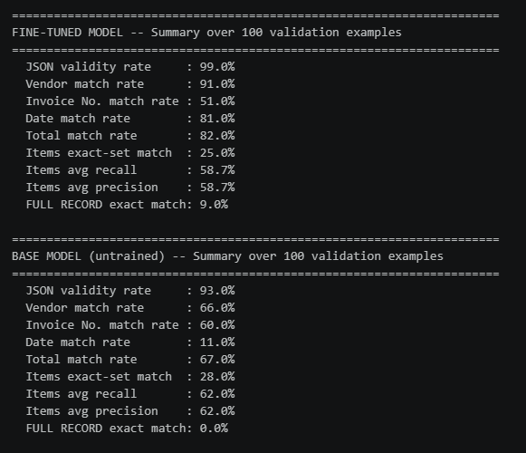
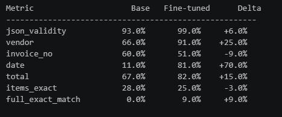

# Qwen2.5-1.5B Fine-Tuning for OCR → Structured JSON Extraction

This project fine-tunes **Qwen2.5-1.5B-Instruct** using **LoRA** to convert messy, noisy OCR text (e.g. scanned invoices with typos, missing spaces, and OCR artifacts) into clean, schema-conformant **JSON** output. It includes a separate validation notebook to measure how well the fine-tuned model performs against the untrained base model on unseen data.

Two notebooks make up this project:
- `finetune_qwen25_1_5b_ocr_json.ipynb` — fine-tunes the model and runs a single qualitative comparison
- `validate_qwen25_1_5b_ocr_json.ipynb` — runs a full quantitative evaluation over a held-out validation set

---

## What Has Been Done

### 1. Fine-Tuning Notebook (`finetune_qwen25_1_5b_ocr_json.ipynb`)

1. **Environment setup**
   Installed `transformers`, `accelerate`, `peft`, `trl`, `datasets`, `bitsandbytes`, and `huggingface_hub`. Verified GPU availability with `nvidia-smi` and installed a matching CUDA build of PyTorch.

2. **Device & precision detection**
   Automatically detects CUDA availability, GPU name, and VRAM. Selects `bf16` on Ampere-class GPUs or newer (compute capability >= 8.0), otherwise falls back to `fp16` or CPU/`fp32`.

3. **Base model**
   Loaded `Qwen/Qwen2.5-1.5B-Instruct` as the base causal language model, quantized to **4-bit (NF4)** via `BitsAndBytesConfig` when running on GPU to reduce memory footprint.

4. **Dataset**
   Loaded custom `train.jsonl` / `val.jsonl` files, each containing chat-style `messages` (system prompt + user OCR text + assistant JSON output). Applied the tokenizer's chat template to format each example into a single training string.

5. **LoRA configuration**
   - Rank (`r`): 16
   - `lora_alpha`: 32
   - `lora_dropout`: 0.05
   - Target modules: `q_proj`, `k_proj`, `v_proj`, `o_proj`, `gate_proj`, `up_proj`, `down_proj` (attention + MLP projections)
   - Task type: `CAUSAL_LM`

6. **Training**
   Used `trl`'s `SFTTrainer` with:
   - 3 epochs
   - Per-device batch size: 2 (with gradient accumulation over 8 steps -> effective batch size 16)
   - Gradient checkpointing enabled
   - Learning rate: `2e-4`, cosine schedule, 3% warmup
   - Evaluation and checkpointing every 50 / 100 steps respectively
   - Mixed precision (`bf16`/`fp16`) depending on GPU capability

7. **Saving the adapter**
   Saved the final LoRA adapter and tokenizer to `./qwen25-1_5b-ocr-json-lora/final_adapter`.

8. **Qualitative comparison**
   Defined a sample messy OCR invoice and a target JSON schema (vendor, invoice number, date, total, line items). Ran the **same prompt** through:
   - The untrained base model
   - The fine-tuned (LoRA-adapted) model

   Extracted and validated the JSON block from each output using a regex-based parser, and compared both against a hand-written expected/ground-truth JSON.

### 2. Validation Notebook (`validate_qwen25_1_5b_ocr_json.ipynb`)

1. **Loads the saved adapter** on top of a freshly loaded base model.

2. **Loads a held-out validation set** (`val_unseen.jsonl`) — examples not used during training.

3. **Generates predictions** for every validation example using greedy decoding (`do_sample=False`), extracting the JSON block from each response.

4. **Field-level comparison** against ground truth for every example:
   - JSON validity (did it parse at all?)
   - Vendor match
   - Invoice number match
   - Date match
   - Total amount match
   - Line-items exact-set match, plus item-level precision/recall

5. **Base vs. fine-tuned comparison**
   Re-evaluates the *same* validation set with the LoRA adapter temporarily disabled (`model.disable_adapter()`), giving an apples-to-apples comparison against the untrained base model without reloading weights from scratch.

6. **Aggregate summary metrics** printed per model:
   - JSON validity rate
   - Per-field match rates (vendor, invoice no., date, total, items)
   - Full-record exact-match rate

7. **Failure inspection**
   Prints the raw output, expected JSON, predicted JSON, and per-field comparison for the first few failing examples, to help diagnose common error patterns.

8. **Results export**
   Writes per-example results to `val_results_finetuned.csv` for further analysis.

---

## Tech Stack

| Component | Purpose |
|---|---|
| **Python** | Core language |
| **PyTorch (CUDA)** | Deep learning backend |
| **Hugging Face `transformers`** | Qwen2.5-1.5B-Instruct model & tokenizer, chat templating |
| **Hugging Face `datasets`** | Loading JSONL train/val/test splits |
| **Hugging Face `peft`** | LoRA adapter creation, loading, and adapter-disable comparison |
| **`trl` (`SFTTrainer`, `SFTConfig`)** | Supervised fine-tuning loop |
| **`bitsandbytes`** | 4-bit (NF4) quantization for memory-efficient training/inference |
| **`accelerate`** | Device placement / multi-GPU support |
| **`huggingface_hub`** | Model download/authentication |
| **Regex + `json`** | Extracting and validating JSON from model output |
| **`csv`** | Exporting per-example evaluation results |

---

## Why This Approach?

- **LoRA fine-tuning** keeps the base Qwen2.5 weights frozen and only trains small adapter matrices in the attention and MLP layers, making it feasible to fine-tune a 1.5B model on a single consumer GPU.
- **4-bit quantization** further reduces memory usage during both training and inference without needing to fully fine-tune in full precision.
- **Structured JSON extraction** is validated field-by-field rather than just checking for an exact string match, since OCR-derived data often has small formatting differences (e.g. date formats, whitespace) that shouldn't be counted as failures if the underlying value is correct.
- **Adapter-disable comparison** in the validation notebook lets the base and fine-tuned model be evaluated on identical hardware/state, isolating the effect of the LoRA adapter itself.

---

## Output Acquired

### Fine-Tuning Notebook — Qualitative Comparison

**Sample raw OCR input:**
```
INV0ICE N0: #7734-C  DATE: 2O26/03/15 VEND0R: Zenith Manufacturing
ITEM S: 1. Hex B0lt M10 - $1,2SO.OO 2. Grinding Wheel 4inch - 3,410.5O
T0TAL: 4,660.50
```




### Validation Notebook — Aggregate Metrics



---

## How to Reproduce

1. Install dependencies:
   ```bash
   pip install -U transformers accelerate peft trl datasets bitsandbytes huggingface_hub
   ```
2. Prepare `train.jsonl` and `val.jsonl` — each line a JSON object with a `messages` list of `{role, content}` dicts (system prompt, user OCR text, assistant ground-truth JSON).
3. Run `finetune_qwen25_1_5b_ocr_json.ipynb` end to end. This saves the LoRA adapter to `./qwen25-1_5b-ocr-json-lora/final_adapter`.
4. Prepare a held-out `val_unseen.jsonl` (examples not seen during training).
5. Run `validate_qwen25_1_5b_ocr_json.ipynb`, pointing `ADAPTER_DIR` and `VAL_PATH` at the correct locations if different from the defaults.
6. Review the printed summary table and `val_results_finetuned.csv` for detailed per-example results.

---

## Notes

- Both notebooks assume an NVIDIA GPU with CUDA for practical training/inference speed; CPU fallback is supported but will be slow.
- `ALSO_EVAL_BASE_MODEL = True` in the validation notebook doubles runtime since it evaluates both the base and fine-tuned model on the full validation set — set to `False` if only fine-tuned numbers are needed.
- Field-level comparisons normalize strings (whitespace/case-insensitive) and numeric amounts (rounded to 2 decimals) before matching, so minor formatting differences don't count as mismatches.